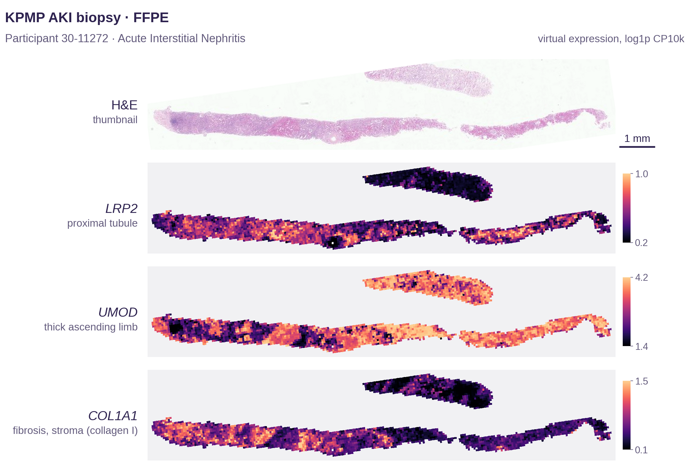
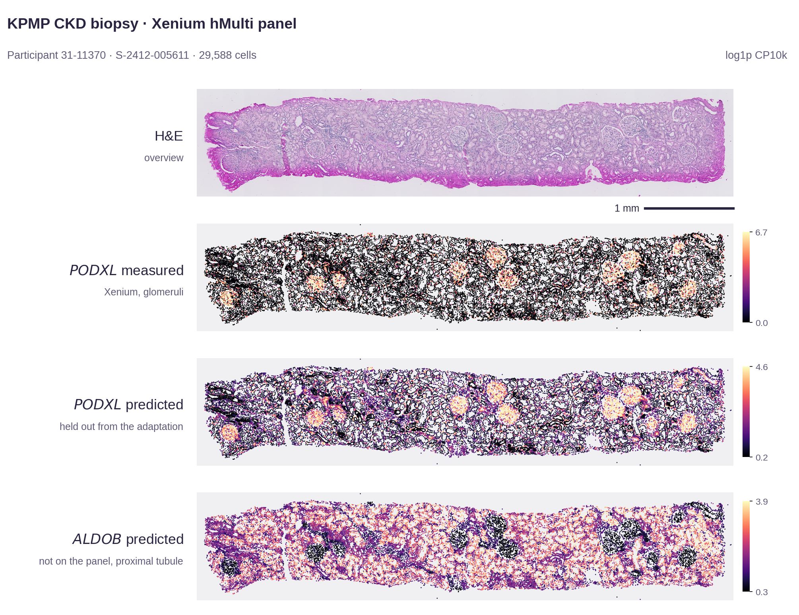

# Virtual spatial transcriptomics links kidney histopathology to disease-associated molecular programs

Analysis code and data for the paper, to reproduce its results.

Routine H&E-stained kidney biopsies are the basis of diagnosis in nephrology, but they do not show the molecular
programs behind the tissue changes. In this study, DeepSpot-M predicts the spatially resolved expression of 19,338 genes
from H&E whole-slide images. It was benchmarked against measured 10x Visium in held-out biopsies of the Kidney
Precision Medicine Project (KPMP) and applied to 1,534 whole-slide images of 476 KPMP participants, giving a virtual
spatial transcriptomics atlas of the human kidney. The predictions were validated with 10x Xenium and in rat kidney
injury (Open TG-GATEs).

## Examples



KPMP biopsy (AKI): H&E and virtual **LRP2** (proximal tubule), **UMOD** (thick ascending limb) and **COL1A1** (fibrosis
and stroma). From the [KPMP virtual spatial transcriptomics atlas](https://huggingface.co/datasets/ratschlab/KPMP_virtual_spatial_transcriptomics_atlas).



KPMP Xenium biopsy (CKD), per cell: H&E, measured and predicted **PODXL** (glomeruli) and virtual **ALDOB** (proximal
tubule; not on the Xenium panel). From the [KPMP Xenium virtual spatial transcriptomics](https://huggingface.co/datasets/ratschlab/KPMP_Xenium_virtual_spatial_transcriptomics)
dataset.

## Results reproduced here

| Figure | Result |
|---|---|
| Figure 2 | Accuracy of virtual spatial transcriptomics against measured 10x Visium in held-out KPMP biopsies, compared with STPath and SQUALL |
| Figure 3 | Transfer to rat kidney injury: virtual injury programs in rat kidney whole-slide images from Open TG-GATEs |
| Figure 4 | Virtual spatial transcriptomics atlas of 1,534 KPMP biopsies: tissue niches, agreement with 10x Xenium, and extension of Xenium panels to 19,338 genes |

## Repository

| Path | Content |
|---|---|
| `src` | Analysis and plotting code, one module per figure |
| `notebooks/reproduce_figures.ipynb` | Recomputes the results from `data` and draws every panel |
| `data` | Processed data for Figures 2, 3 and 4 |
| `fonts` | Liberation Sans, the typeface of the figures |
| `assets` | Example images shown above |

## Quick start

Python 3.12:

```bash
python -m venv .venv
source .venv/bin/activate
pip install -r requirements.txt
jupyter nbconvert --to notebook --execute notebooks/reproduce_figures.ipynb --output-dir outputs
```

Figures are written to `outputs` as PDF and PNG (`figure2.pdf`, `figure2.png`, ...), result tables to `outputs/tables`.

## Related resources

| Resource | Link |
|---|---|
| KPMP virtual spatial transcriptomics atlas | https://huggingface.co/datasets/ratschlab/KPMP_virtual_spatial_transcriptomics_atlas |
| KPMP Xenium virtual spatial transcriptomics | https://huggingface.co/datasets/ratschlab/KPMP_Xenium_virtual_spatial_transcriptomics |
| DeepSpot-M model weights | https://huggingface.co/ratschlab/DeepSpotM |
| DeepSpot-M code | https://github.com/ratschlab/DeepSpotM |
| DeepSpot-M preprint | https://www.medrxiv.org/content/10.64898/2026.06.19.26356060 |

## Data sources and licences

| Path | Source | Licence |
|---|---|---|
| `data/figure2`, `data/figure4`, `assets` | Kidney Precision Medicine Project (KPMP), https://www.kpmp.org | KPMP data use terms; attribution below |
| `data/figure3` | Open TG-GATEs, National Institutes of Biomedical Innovation, Health and Nutrition, https://dbarchive.biosciencedbc.jp/en/open-tggates/ | CC BY-SA 2.1 JP, https://creativecommons.org/licenses/by-sa/2.1/jp/ |
| `fonts` | Liberation Sans 2.1, https://github.com/liberationfonts | SIL Open Font License 1.1 (`fonts/LICENSE`) |
| `src`, `notebooks` | This repository | MIT (`LICENSE`) |

KPMP: The results here are in whole or part based upon data generated by the Kidney Precision Medicine Project
(https://www.kpmp.org), funded by the National Institute of Diabetes and Digestive and Kidney Diseases (NIDDK).

Open TG-GATEs: `data/figure3` is derived from Open TG-GATEs and is distributed under the same licence,
CC BY-SA 2.1 JP.

## Citation

Nonchev K, Jang Y, Nlandu Khodo S, Koelzer VH, Rätsch G, Moor MB. Virtual spatial transcriptomics links kidney
histopathology to disease-associated molecular programs. Journal details will be added on publication.

Metadata for citing this repository: `CITATION.cff`.
